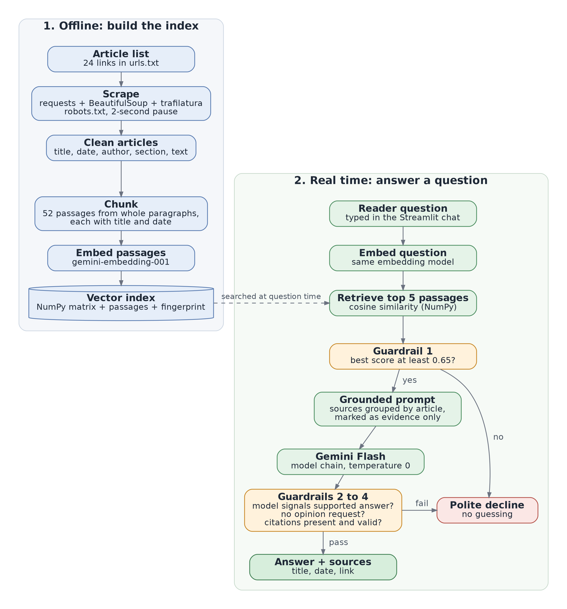
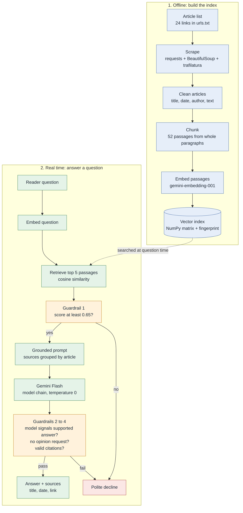

# Design document: Johor State Election 2026 Q&A (RAG prototype)

## 1. System design

Mermaid source of the same diagram

## 2. Component choices

| Component | Choice | Why |
|---|---|---|
| Ingestion | `requests` + BeautifulSoup (metadata) and `trafilatura` (article body) over a fixed list of 24 links | The pages are server-rendered, so no browser is needed. A fixed list keeps the scope exact (2026 only). The scraper respects robots.txt, pauses between requests, and takes the publish date from the link, because pages can show a later "updated" time. |
| Chunking | Whole paragraphs grouped into 52 passages (median 164 words), each embedded with its title and date | News paragraphs are self-contained; the title and date give each passage context and make citations possible. |
| Embeddings | Gemini `gemini-embedding-001`, with Sentence Transformers `all-MiniLM-L6-v2` as a backup | Chosen by test on development questions: a passage from the right article was retrieved for 12/12 questions (MRR 0.958), against 11/12 (0.875) for the backup. |
| Vector index | NumPy matrix, exact cosine similarity | At 52 passages a full comparison takes milliseconds, and FAISS returned identical results. A fingerprint and model check stop passages from being paired with embeddings built for different text or by a different model. |
| Answer model | Gemini Flash at temperature 0, through a chain of models | Free-tier limits are counted per project and per model. If a model hits its daily limit or isn't available to the key, the next is tried. |
| Guardrails | (1) similarity cut-off 0.65; (2) sources grouped by article inside `<source>` tags marked as evidence only, with instructions inside them ignored; (3) the model replies NOT_IN_SOURCES or OPINION_REQUEST, and the code checks for these signals; (4) at least one citation, and every citation must match a listed source | Similarity measures topic closeness, not whether the answer is present: "Who won the Melaka state election?" scored 0.701, beside in-scope questions (lowest 0.702). Layer 1 stops clearly unrelated questions without an LLM call; the prompt rules declined Melaka and Negeri Sembilan. |
| Interface | Streamlit chat page | Shows sources as links, and a details switch shows each answer's decision, score and model. |

Evaluation results (development checks and a fresh final check) are reported in the README.

## 3. Production and scale

### 3.1 Scaling to 100,000 articles
- **Ingestion:** a scheduled crawler reads sitemaps and RSS feeds into a queue processed by parallel workers. Raw and parsed articles are stored in cloud storage, and unchanged articles are skipped using a content hash.
- **Embedding:** only new or changed articles are embedded, in batches (Vertex AI batch embedding, or Sentence Transformers on a GPU worker). That's roughly 400,000 passages.
- **Index:** move to an approximate nearest-neighbour index: FAISS (HNSW or IVF), or a managed vector database such as Vertex AI Vector Search or pgvector.
- **Search quality and scope:** store topic, state, date and section with every passage and filter on them before searching, so answers stay in scope across topics. Add keyword search (BM25) for exact names such as seats and candidates, then rerank the results.
- **Serving:** a stateless API (e.g. Cloud Run), caching of frequent questions, and paid quotas instead of free-tier limits.

### 3.2 Breaking news on election night
- **Fast ingestion:** poll RSS and sitemaps every 1–2 minutes (or take a push from the publishing system), then index new passages within minutes.
- **Live-results articles:** re-scrape them on every update and replace their old passages, versioned by content hash, so outdated counts disappear.
- **Freshness:** keep publish and update times on every passage, rank newer passages higher for results questions, tell the model to prefer the latest source when figures conflict, and show "as of [time]" with each answer.
- **Unofficial figures:** label them until the Election Commission confirms them, and cache answers only briefly.

### 3.3 Monitoring hallucination and political bias
- **Release tests:** a development set, plus a held-back set never used for tuning. They cover in-scope questions with labelled evidence passages, out-of-scope questions, opinion requests and prompt-injection attempts. A release is blocked if accuracy or correct refusals drop.
- **Grounding:** require a citation on every sentence, and use a judge or textual-entailment model to confirm that the cited passage supports it. Run this on sampled live traffic, track the unsupported-sentence rate, and log the raw output of refused answers.
- **Feedback:** log questions, retrieved passages, answers and decisions, with thumbs-up and thumbs-down feedback for review.
- **Political bias:** check that parties and coalitions get balanced coverage in the index, and ask paired questions per party to compare tone, length and refusal rates. Keep the neutrality and no-voting-advice rules, and have editors review a sample of sensitive answers.

## 4. Limitations
- **Small collection:** 24 articles, so uncovered questions are declined (e.g. the brief's Pulai example).
- **Citation check:** confirms citations are present and valid, not that every sentence is supported.
- **Small evaluation sets:** the cut-off was set on development questions; only the 6-question final check is independent.
- **Interactive results pages:** only their text summaries are captured.
- **Dependence on Gemini:** both search and answers call Gemini, so free-tier limits can cause a temporary "try again later".
